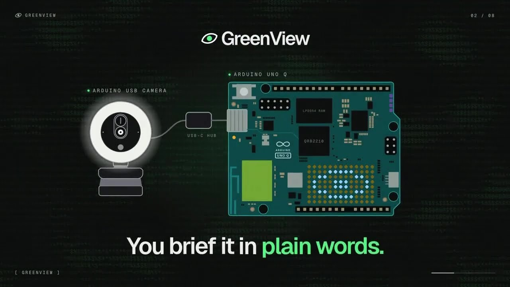

<h1 align="center">GreenView</h1>

<p align="center">Describe wasted heat, light or litter in plain words.</p>

<p align="center">
  <a href="https://youtu.be/vr6mMQcDaaE">
    
  </a>
</p>

A window left open above a radiator. Lights burning in an empty room. Rubbish beside the recycling point. Much everyday waste is visible, but someone has to notice it and act.

GreenView’s idea is a small camera on an **Arduino UNO Q** that the people who know a place can brief themselves:

- *“Alert me if a window stays open for five minutes while the room is above 18°C.”*
- *“Alert me when the lights are on and the room has been empty for ten minutes.”*
- *“Alert me when rubbish is left next to the recycling point.”*

## How it works

1. **Compile once.** Gemini turns a new rule into a yes/no question, a hold duration and an optional temperature threshold. It receives the rule text, not camera frames.
2. **Answer locally.** The board runtime uses Gemma 4 E2B through LiteRT-LM to answer questions about individual images. It keeps time and reads temperature from a Modulino Thermo.
3. **Send the alert.** When confirming observations span the requested duration, an event is saved to SQLite and delivered through ntfy. The outbox retries when connectivity returns.

Images and individual answers stay on the local network. Owners manage rules on the web and read live progress on the board’s LAN page. The aim is local monitoring whose rules can change without collecting a new training dataset for each room.

Built at Junction 2026 for Arduino’s **The Green European Renaissance** challenge. The repository includes the runtime and training/export tools; it currently uses the stock model. Fine-tuning results and memory fit on the UNO Q remain unverified.

## Run locally

Use npm 11 and set the web credentials listed in [.env.example](.env.example).

```sh
npm ci
npm run dev
```

Open [localhost:3000](http://localhost:3000). Monitoring also needs a UNO Q, USB camera, Modulino Thermo and a local model. Follow the [board setup](docs/DEVELOPMENT.md#setup) for provisioning, model installation and ntfy subscriptions.
